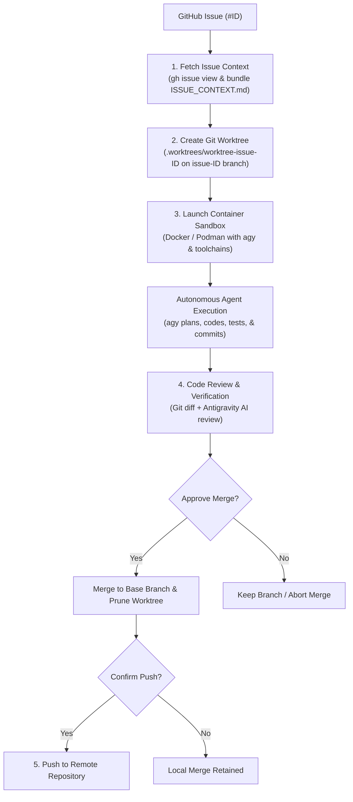

# agy-automation

An OS-agnostic, project-agnostic autonomous issue-resolution pipeline powered by the **Antigravity CLI (`agy`)**, **Git worktrees**, and **Docker/Podman sandboxing**.

`agy-automation` enables AI agents to autonomously fetch GitHub issues, spin up an isolated Git worktree, run full-context fixes and tests inside a secure container sandbox, generate an AI code review with a git diff, and facilitate an interactive merge and push workflow—**all without polluting your target repository's Git history or configuration**.

---

## Architecture Overview

The pipeline orchestrates an isolated, safe loop from issue pickup to remote push:



### Execution Lifecycle

1. **Issue Fetch (`fetch-issue`)**: Interacts with the GitHub CLI (`gh`) to fetch title, description, labels, and comments, writing a structured `ISSUE_CONTEXT.md`.
2. **Worktree Isolation (`create-worktree`)**: Creates an isolated Git worktree under `.worktrees/worktree-issue-<id>` branching off your current active branch.
3. **Sandboxed Execution (`run-sandbox` & `container-agent-runner`)**: Mounts the target codebase into a multi-language container sandbox (Docker or Podman) with memory and CPU boundaries. The container runs `agy` in headless mode to understand the issue, modify files, run tests, and create a conventional Git commit.
4. **AI Review & Interactive Merge (`review-merge`)**: Compares changes against the base branch, prints the unified diff, runs an Antigravity AI code review, and prompts the user for merge approval. If approved, fast-forward merges the branch into the base branch and safely removes the worktree.
5. **Remote Push (`push-changes`)**: Prompts the user to confirm pushing the newly merged commits to the upstream remote repository.

---

## Decoupled Architecture

`agy-automation` is engineered to run from any location against **any target repository** without modifying the repository's tracked files:

- **Target vs. Toolkit Separation**:
  - `TOOLKIT_DIR`: Resolves to where `agy-automation` is installed (scripts, container specifications, sandbox MCP configs).
  - `TARGET_REPO`: Automatically detected via `git rev-parse --show-toplevel` from your current terminal directory.
- **Zero Repo Pollution (`.git/info/exclude`)**:
  - The coordinator automatically appends `.worktrees/` and `ISSUE_CONTEXT.md` to your target project's `.git/info/exclude`.
  - Your repository's tracked `.gitignore` remains completely untouched and clean.
- **Dynamic Container Scoping**:
  - Container and image names are derived from the target repository directory (e.g., `my-project-sandbox`), ensuring multiple concurrent repositories do not conflict.
- **Credential & Config Isolation**:
  - Host Antigravity credentials (`~/.gemini`) are mounted directly into the container so authentication works seamlessly.
  - An isolated `sandbox-mcp-config.json` is mounted into the container to prevent host MCP servers (such as local desktop GUI apps or Windows binaries) from spawning inside Linux containers.
  - A dedicated `.gitconfig.sandbox` is dynamically generated in the toolkit directory reflecting your host Git identity without altering the target project's configuration.

---

## Prerequisites

Ensure the following tools are installed on your host machine:

| Tool | Minimum Version | Purpose |
| :--- | :--- | :--- |
| **Git** | `2.30+` | Version control & worktree management (`git worktree`) |
| **GitHub CLI (`gh`)** | Latest | Issue fetching (`gh issue view`). Must be authenticated via `gh auth login` |
| **Antigravity CLI (`agy`)** | Latest | Autonomous AI coding agent (`https://antigravity.google/cli`) |
| **Docker** or **Podman** | Latest | Sandboxed container runtime (`docker compose` or `podman compose`) |

---

## Global Installation Guide

Clone this repository to a permanent directory on your machine:

```bash
git clone https://github.com/your-username/agy-automation.git
```

### Windows Installation

1. Note the path to the `bin/` folder (e.g., `D:\Toolkits\agy-automation\bin` or `C:\agy-automation\bin`).
2. Add this path to your User `PATH` environment variable:

```powershell
# In an elevated or standard PowerShell terminal:
$toolkitBin = "D:\Toolkits\agy-automation\bin"
[Environment]::SetEnvironmentVariable("PATH", $env:PATH + ";$toolkitBin", [EnvironmentVariableTarget]::User)
```

Alternatively, open **System Properties** -> **Environment Variables**, select `Path` under User variables, and add the directory.

3. Restart your terminal. You can now invoke `start-issue` from any Git repository.

### Linux / macOS Installation

1. Note the path to the `bin/` directory (e.g., `~/.agy-automation/bin`).
2. Add the directory to your `~/.bashrc` or `~/.zshrc`:

```bash
echo 'export PATH="$HOME/agy-automation/bin:$PATH"' >> ~/.bashrc
source ~/.bashrc
```

3. Alternatively, create a symlink directly in `/usr/local/bin`:

```bash
sudo ln -s /path/to/agy-automation/bin/start-issue /usr/local/bin/start-issue
```

4. Verify executable permissions:

```bash
chmod +x /path/to/agy-automation/bin/start-issue
chmod +x /path/to/agy-automation/start-issue.sh
chmod +x /path/to/agy-automation/scripts/*.sh
```

---

## Usage Guide & CLI Options

Navigate to **any** target Git repository on your machine and run `start-issue`:

```bash
# Work on GitHub issue #42
start-issue 42

# Interactive prompt (prompts for issue number)
start-issue
```

### CLI Flags & Arguments

Both PowerShell (`start-issue.ps1`) and Bash (`start-issue.sh`) support identical configuration options:

```bash
# Force container image rebuild before running
start-issue 42 -BuildSandbox          # PowerShell
start-issue 42 --build                # Bash

# Open interactive bash shell inside the sandbox instead of automated runner
start-issue 42 -InteractiveSandbox    # PowerShell
start-issue 42 --interactive          # Bash

# Explicitly choose container engine (podman or docker)
start-issue 42 -ContainerEngine podman # PowerShell
start-issue 42 --engine docker        # Bash

# Dry-run mode: fetch issue & validate execution plan without creating branches or containers
start-issue 42 -DryRun                # PowerShell
start-issue 42 --dry-run              # Bash
```

---

## Customization & Extensibility

### 1. Extending the Container Sandbox (`Dockerfile.sandbox`)
The base sandbox is built on Ubuntu 24.04 and comes pre-loaded with:
- **Node.js 22 LTS** & `npm`
- **Java 21 (OpenJDK)** & `maven`
- **Python 3** & `pip` / `venv`
- **Git**, `build-essential`, and `agy`

To add runtimes for your stack (e.g. Go, Rust, Ruby, PHP), simply extend [Dockerfile.sandbox](file:///D:/projects/Toolkits/agy-automation/Dockerfile.sandbox):

```dockerfile
# Add Rust toolchain
RUN curl --proto '=https' --tlsv1.2 -sSf https://sh.rustup.rs | sh -s -- -y
ENV PATH="/root/.cargo/bin:${PATH}"

# Add Go toolchain
RUN apt-get update && apt-get install -y --no-install-recommends golang-go
```

Rebuild the image with `start-issue <id> --build` or `docker compose -f docker-compose.sandbox.yml build`.

### 2. Resource Boundaries & tmpfs Mounts
[docker-compose.sandbox.yml](file:///D:/projects/Toolkits/agy-automation/docker-compose.sandbox.yml) contains strict memory and disk protection:
- **Memory limit**: Capped at `3500MB` (with `4096MB` swap) to prevent out-of-memory starvation on host systems.
- **CPU quota**: Capped at `4.0` cores.
- **tmpfs mounts**: Mounts `/tmp`, `/root/.npm`, and `/root/.cache` in memory so ephemeral build artifacts do not inflate host disk images (e.g., WSL2 VHDX files).

### 3. Agent Instructions & Repository Standards (`AGENT_INSTRUCTIONS.md`)
The toolkit automatically detects repository-specific standards and AI workflow instructions defined in an `AGENT_INSTRUCTIONS.md` (or `agent_instructions.md` / `AGENT_INSTRUCTIONS.MD`) file placed in your target project's root:

- **Automatic Discovery**: When present in the target repository root, the toolkit detects the file and passes its guidelines into the sandboxed agent.
- **Strict Sequence & Standards**: The agent first analyzes the issue context and codebase, and then strictly follows the workflow sequence specified in `AGENT_INSTRUCTIONS.md`—ensuring documentation, tests, and code writing are executed in the exact prescribed order to maintain standard across every agent run.
- **Graceful Fallback**: If `AGENT_INSTRUCTIONS.md` is not present, the agent automatically proceeds with the standard, battle-tested issue resolution workflow without interruption.
- **Review Verification**: The AI code reviewer in the merge step also assesses compliance with the repository instructions before you approve the merge.

Autonomous agent behavior and prompt templates can also be further customized in [scripts/container-agent-runner.sh](file:///D:/projects/Toolkits/agy-automation/scripts/container-agent-runner.sh#L37-L53).

---

## License

This project is licensed under the [MIT License](file:///D:/projects/Toolkits/agy-automation/LICENSE).
