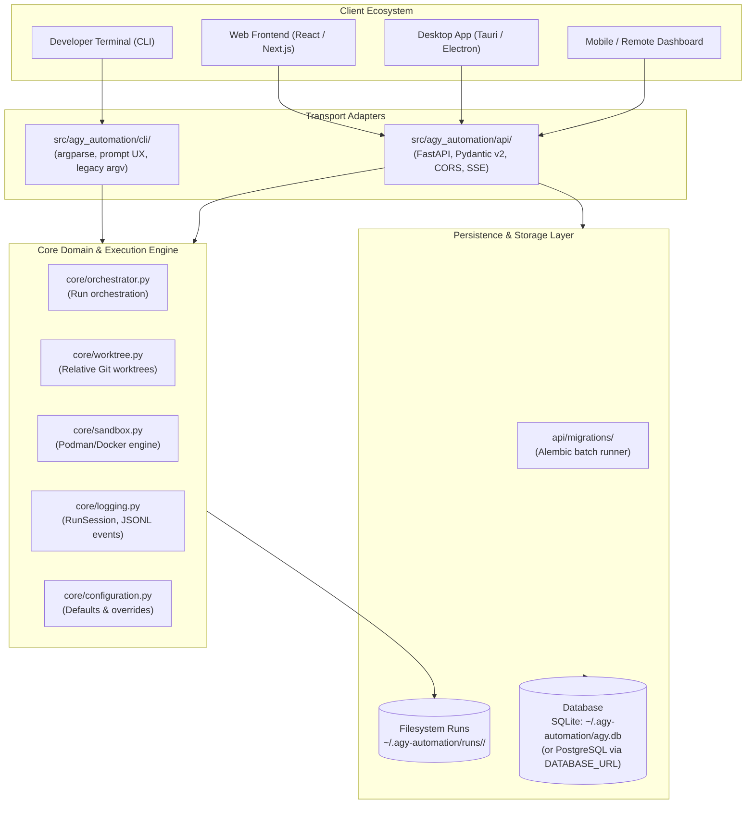
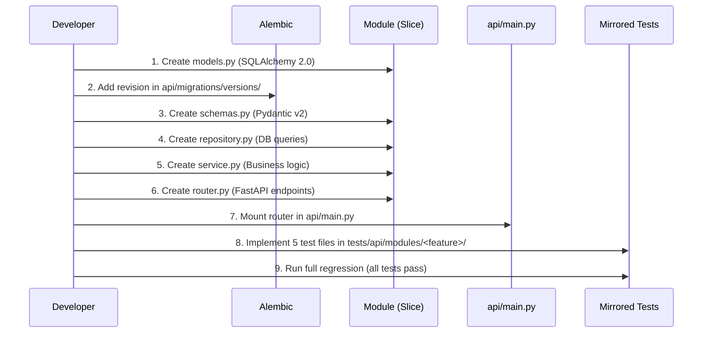

# System Architecture & Development Constitution

This document serves as the **definitive architectural blueprint, expansion guide, and development constitution** for the `agy-automation` toolkit. It establishes the system philosophy, component boundaries, coding conventions, subsystem extension recipes, and frontend integration contracts.

---

## 1. System Vision & Philosophy

### Problem Statement
Running autonomous AI coding agents directly inside developer repositories without strict isolation poses high risks:
1. Untracked file modifications or uncommitted changes on the active branch.
2. Arbitrary code execution during test execution or build tasks.
3. Host workspace pollution (temporary caches, dependencies, rogue containers).
4. Lack of standardized telemetry, cost tracking, and programmatic remote control.

### Core Mission
`agy-automation` provides a **reproducible, permissionless, and dual-entrypoint (CLI & REST API) autonomous orchestration pipeline**. It isolates AI agent runs inside **ephemeral Git worktrees** and **rootless containers** (Docker/Podman), protecting the developer's host repository while providing complete observability and multi-client accessibility.

### Guiding Principles
- **Host Workspace Sanctity**: The developer's primary working tree is never modified directly during an agent run. All changes occur in isolated worktrees and are merged only after user review.
- **Hexagonal Separation**: Domain logic (`core/`) remains 100% agnostic of transport layers. The CLI (`cli/`) and the Web API (`api/`) are independent, interchangeable adapters.
- **Portability by Default**: Zero host lock-in. Default persistence uses local SQLite, fully portable to PostgreSQL via a single connection string without code modifications.
- **Strict Verification Gate**: Code changes must satisfy rigorous layer-by-layer automated testing before being considered complete.

---

## 2. Hexagonal System Topology

The system is structured as a Hexagonal (Ports & Adapters) architecture:



### Component Roles & Boundaries

| Component | Path | Responsibility | Boundary Invariants |
| :--- | :--- | :--- | :--- |
| **Core Domain** | `src/agy_automation/core/` | Worktree management, container lifecycle, agent runners, telemetry logging, issue fetching & listing (`fetch_issue.py`), git review/merge. | **NO** web framework dependencies (no FastAPI/Starlette). **NO** CLI parsing. Pure Python & standard library. Functions accept optional `repo_dir` for API scoping while defaulting to `None` for CLI compatibility. |
| **CLI Adapter** | `src/agy_automation/cli/` | Terminal argument parsing, PowerShell syntax normalization (`-Flag:Val`), interactive prompts. | Interacts exclusively with `core/` functions and dataclasses. Does not directly query the database. |
| **API Adapter** | `src/agy_automation/api/` | REST API, OpenAPI docs, Pydantic validation, CORS, request timing, lifespan database migrations. | Mounts vertical feature slices (`projects/` with `issues/` sub-module, `runs/` engine). Injects database sessions via dependencies. Coordinates background execution using `CallerMode.API`. |
| **Database & Migrations** | `src/agy_automation/api/common/` & `api/migrations/` | SQLAlchemy 2.0 ORM, Alembic schema migrations, connection pooling. | All schema changes are tracked in versioned migration files with `render_as_batch=True`. Tables: `projects`, `runs`. |

---

### 5. Caller Inversion Pattern (`CallerMode`)
The master 5-step pipeline coordinator (`core/orchestrator.py:run_pipeline()`) remains the single source of truth for execution order:
1. `Context` $\rightarrow$ 2. `Worktree` $\rightarrow$ 3. `Sandbox` $\rightarrow$ 4. `Review` $\rightarrow$ 5. `Push`.

Callers specify their execution nature via `PipelineContext(caller_mode=CallerMode.CLI | CallerMode.API)`:
* **CLI Mode**: Interactive terminal prompts (`input()`), standard error/output colors.
* **API Mode**: Background worker thread coordinates via `RunManager`, emitting `awaiting_review` SSE events and waiting on an in-memory event until `PUT /api/runs/{id}/review` is submitted (or resuming directly from SQLite and git worktree if interrupted).

---

## 3. Coding Standards & Architectural Invariants

### 1. Vertical Feature Slices & Sub-Modules in API
The API is organized by business feature (aggregate root) rather than technical layer. Subordinate features that belong strictly to a parent resource live as clean sub-modules:
```text
src/agy_automation/api/modules/<feature>/
├── __init__.py
├── models.py       # SQLAlchemy 2.0 typed ORM entity
├── schemas.py      # Pydantic v2 validation models
├── repository.py   # Pure database query operations
├── service.py      # Business logic & external validations
├── router.py       # FastAPI HTTP endpoints / Controllers
│
├── <sub_feature>/  # Example: projects/issues/ (Subordinate resource)
│   ├── __init__.py
│   ├── schemas.py  # Sub-resource Pydantic schemas
│   ├── service.py  # Domain coordination with core functions
│   └── router.py   # Sub-router mounted onto parent router
│
└── runs/           # Autonomous and interactive runs execution engine
    ├── __init__.py
    ├── models.py   # Run entity (status, timings, conversation_id)
    ├── schemas.py  # RunCreateRequest, RunReviewRequest, RunDiffResponse
    ├── repository.py # Runs queries & status updates
    ├── service.py  # Background worker & in-memory RunManager coordination
    └── router.py   # Endpoints (/api/runs, /diff, /review, /stream SSE)
```

### 2. Mirrored 5-Layer Test Suite
Every feature module and sub-module in `src/agy_automation/api/modules/` must have a 1:1 mirrored test directory under `tests/api/modules/`:

```text
tests/api/modules/<feature>/
├── test_models.py      # Layer 1: ORM entity definitions, defaults, constraints
├── test_schemas.py     # Layer 2: Pydantic validation, boundary rejection, serialization
├── test_repository.py  # Layer 3: Database operations using isolated in-memory SQLite
├── test_service.py     # Layer 4: Service logic with external mocks (git/filesystem)
├── test_router.py      # Layer 5: HTTP endpoints tested via FastAPI TestClient
│
└── <sub_feature>/      # Mirrored sub-module tests (e.g., projects/issues/)
    ├── test_schemas.py
    ├── test_service.py
    └── test_router.py
```
- **Isolation Guarantee**: All database tests run against `sqlite:///:memory:` with fresh tables generated per test. Tests **never** write to `~/.agy-automation/agy.db`.

### 3. Worktree Relative Path Portability
- **Crucial Rule**: Never run `git config worktree.useRelativePaths true` on host repositories. This command causes newer Git engines (e.g. Git 2.56 in containers) to inject `[extensions] relativeWorktrees = true` into `.git/config`, crashing host Git 2.43.
- **Correct Pattern**: When creating worktrees in `core/worktree.py`, write relative pointers directly into the worktree `.git` file (`gitdir: ../../.git/worktrees/<name>`).

### 4. Unified Logging Hierarchy
- All modules (CLI, API, and Core) must obtain loggers using:
  ```python
  from agy_automation.core.logging import get_logger
  logger = get_logger("agy_automation.<subsystem>")
  ```
- Sub-loggers automatically inherit standard formatting (`%(asctime)s [%(levelname)s] %(name)s: %(message)s`) and log levels configured by `configure_logging()`.
- Run-level event streams use `RunSession` to persist `metadata.json` and `events.jsonl` under `~/.agy-automation/runs/<run_id>/`.

### 5. Modern Typing & Schema Conventions
- **SQLAlchemy 2.0**: Use modern typed mappings:
  ```python
  class Entity(Base):
      __tablename__ = "entities"
      id: Mapped[str] = mapped_column(String(36), primary_key=True)
      is_active: Mapped[bool] = mapped_column(Boolean, default=False)
  ```
- **Pydantic v2**: Use `model_config = ConfigDict(from_attributes=True)` for ORM serialization. Use `@field_validator` with class methods for data integrity.

---

## 4. Subsystem Expansion Guide: Adding to `core/`

When adding new low-level engines (e.g., **Container Management Engine**, **Usage Tracker**), adhere to the following contract:

### Blueprint A: Container Management Engine (`core/container_engine.py`)
1. **Auto-Detection**: Dynamically detect `podman` vs `docker` on the host PATH. Fall back gracefully with clear error messages.
2. **Lifecycle State Machine**:
   ```mermaid
   stateDiagram-v2
       [*] --> DETECTED: detect_engine()
       DETECTED --> IMAGE_CHECKED: inspect_image()
       IMAGE_CHECKED --> IMAGE_BUILT: build_image()
       IMAGE_CHECKED --> WORKTREE_MOUNTED: image_exists
       IMAGE_BUILT --> WORKTREE_MOUNTED: mount_worktree()
       WORKTREE_MOUNTED --> RUNNING: run_container()
       RUNNING --> FINISHED: process_exit
       RUNNING --> TERMINATED: abort()
       FINISHED --> CLEANED_UP: cleanup()
       TERMINATED --> CLEANED_UP: cleanup()
       CLEANED_UP --> [*]
   ```
3. **Volume Mount Guarantees**:
   - The target worktree directory must be mounted as `/workspace` with read-write permissions (`:Z` flag on SELinux systems).
   - Host `~/.gemini` or credentials must be passed through read-only environment variables or ephemeral mounts.
4. **Guaranteed Cleanup**: Always register cleanup traps or context managers ensuring background containers are killed and pruned even if the host Python process receives `SIGINT` or crashes.

### Blueprint B: Token & Cost Usage Tracker (`core/telemetry/`)
1. **Telemetry Ingestion**: Intercept Antigravity CLI runner stdout events for token counts:
   - `input_tokens`, `output_tokens`, `cache_read_tokens`.
2. **Model Pricing Matrix**: Maintain a configurable model pricing table (e.g. Gemini 1.5 Pro, Flash, Claude, GPT-4) mapping tokens to USD cost.
3. **Session Rollup**: Compute cumulative run duration, total token consumption, and estimated dollar cost, saving the output directly into `RunSession.metadata["usage"]`.

---

## 5. API Module Expansion Guide: Adding to `api/modules/`

To add a new API capability (e.g., `runs/`, `containers/`, `chat/`):

### Step-by-Step Implementation Recipe



1. **Model**: Define the database entity in `src/agy_automation/api/modules/<feature>/models.py` inheriting from `Base`.
2. **Migration**: Generate or write a new migration file in `src/agy_automation/api/migrations/versions/` with `upgrade()` and `downgrade()`.
3. **Schemas**: Define input/output Pydantic schemas in `schemas.py` with strict validation.
4. **Repository**: Implement query functions taking `db: Session`. Keep all database logic contained in this file.
5. **Service**: Implement core validations and domain coordination.
6. **Router**: Create an `APIRouter(prefix="/<feature>", tags=["<feature>"])`. If the module requires an active project, add `dependencies=[Depends(require_active_project)]`.
7. **Mount**: Include the router in `src/agy_automation/api/main.py` under the `/api` prefix.
8. **Mirrored Tests**: Add `test_models.py`, `test_schemas.py`, `test_repository.py`, `test_service.py`, and `test_router.py` under `tests/api/modules/<feature>/`. Verify 100% pass rate.

---

## 6. Client Ecosystem & Frontend Integration

The FastAPI backend is designed to serve any client type without transport lock-in:

### A. Web Frontends (React / Next.js / Vue / Svelte)
- **Base URL**: `http://127.0.0.1:8000/api`
- **CORS**: Global CORS is pre-configured to allow local frontend development servers (`http://localhost:3000`, `http://localhost:5173`, etc.).
- **Log Streaming via SSE (Server-Sent Events)**:
  - Long-running agent execution logs and telemetry events will be streamed via `GET /api/runs/{run_id}/stream` returning `text/event-stream`.
  - Web clients consume events using native browser `EventSource`:
    ```javascript
    const eventSource = new EventSource('/api/runs/20261102_demo_1/stream');
    eventSource.onmessage = (event) => {
      const data = JSON.parse(event.data);
      console.log(`[${data.type}]`, data.payload);
    };
    ```

### B. Desktop & Native Frontends (Tauri / Electron)
- **Local Process Architecture**:
  - Desktop applications can spawn the Python backend as a bundled sidecar or run `uv run agy-automation serve --port 8000` in the background.
  - Native OS file-pickers supply absolute directory paths directly to `POST /api/projects`.
- **Offline / Zero Network Dependency**: The API runs on localhost with zero external cloud dependencies.

### C. Mobile Frontends (React Native / Flutter)
- **Remote Host Monitoring**:
  - Connects to an `agy-automation` server running on a workstation or cloud devbox via a secure tunnel (e.g. Tailscale, SSH port forward).
  - Can inspect project status, monitor active run progress, view token usage, and approve interactive Git merges remotely.

---

## 7. Spec Kit Development Constitution

The following non-negotiable rules govern all code generation, refactoring, and feature additions in this repository. These principles are formatted for direct adoption into `.specify/memory/constitution.md`:

### Principle 1: Zero Host Contamination
- Dependencies must be managed strictly inside the local `.venv` using `uv`. Never install packages to the host global Python.
- Never modify files in the host Git repository outside the dedicated `.worktrees/` directory during an issue run.

### Principle 2: Architectural Separation
- `core/` must never import from `api/` or `cli/`.
- `api/` and `cli/` are transport adapters; neither should implement raw domain algorithms that belong in `core/`.

### Principle 3: Persistence Portability
- All database models and queries must use standard SQLAlchemy 2.0 constructs compatible with both SQLite and PostgreSQL.
- Database migrations must support SQLite batch alterations via `render_as_batch=True`.

### Principle 4: Strict Input Validation
- All project filesystem paths must be validated as absolute (`Path.is_absolute()`). Relative paths must be rejected with HTTP 422.
- All project directories must be verified as valid Git repositories before registration.

### Principle 5: Test Integrity & Regression Gate
- Every new feature must be accompanied by mirrored tests covering models, schemas, repositories, services, and controllers.
- No code may be merged if any existing tests fail. All unit, integration, and regression suites must pass cleanly.
